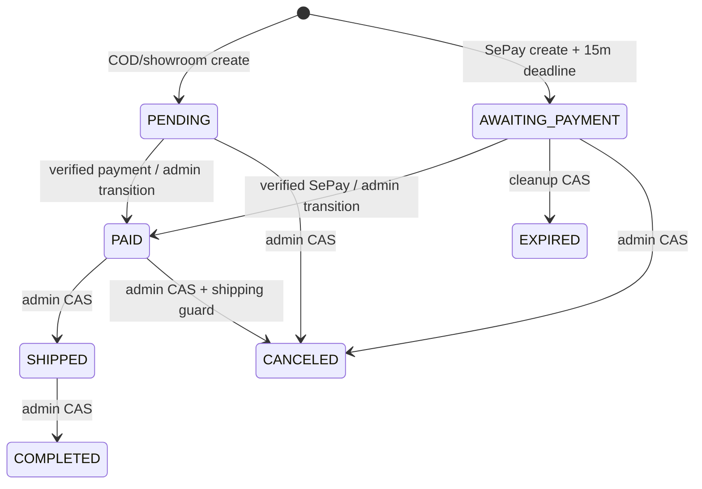
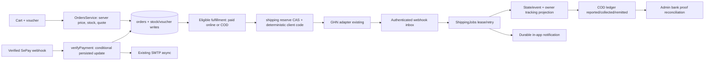
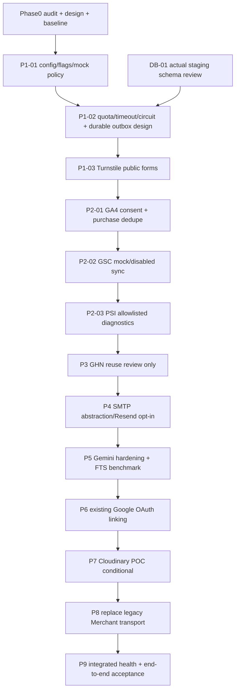

# Architecture, state ownership và rollback

03/11/2026 — technical design; observed DB ERD và migration decisions đã đối chiếu owner export trong [04-schema-review.md](04-schema-review.md). Export environment chưa xác nhận, không phải hosted deployment certification.

## Order/payment/shipping state machines hiện có

Commercial status do OrdersService/transition_order/DB trigger sở hữu. Payment_status riêng `pending/paid/failed/refunded` theo schema; SePay code xử lý pending→paid qua persisted conditional update; chưa có refund bank workflow. Trigger đặt paid khi chuyển commercial PAID; vì vậy admin transition cũng có ảnh hưởng tài chính, cần giữ RBAC/audit. Late payment trên SHIPPED/COMPLETED giữ commercial status, không revive CANCELED/EXPIRED. Order create và payment confirmation là hai thời điểm khác nhau.

Shipment state mapping: SHIPMENT_PENDING→SHIPMENT_CREATED→PICKUP_PENDING→IN_TRANSIT→OUT_FOR_DELIVERY→DELIVERED; DELIVERY_FAILED có thể redelivery/RETURN_REQUESTED→RETURNING→RETURNED; CANCELLED và terminal states không tự quay lại; unknown→MANUAL_REVIEW. Source: shipment-state.ts. GHN delivery không ghi payment paid. COD bank confirmed phải qua approval/proof, không tự coi provider collected là tiền đã về.

## Event ownership và outbox

| Producer | Hiện tại | Target opt-in |
| --- | --- | --- |
| Order created | DB insert, chưa email confirmation từ create | Transaction event sau persisted create; một order/recipient/template key |
| SePay verified | payment CAS, async SMTP | Ghi durable payment-confirmed event cùng transaction trước email/GA4; không chỉ enqueue sau commit vì crash gap |
| Admin order state | transition_order RPC, async SMTP | RPC transaction ghi event; expected-state/CAS giữ nguyên |
| GHN inbox processed | shipping event + in-app notification | Bridge notification identity vào email outbox, không tạo lại shipping inbox |
| Product publish/price/stock | product service writes | version/content-hash delta → search/AI cache/Merchant; không outbound blocking checkout |

Exactly-once email không thể được bảo đảm bằng in-memory Set. Provider timeout sau accept phải UNKNOWN/reconcile, không failover SMTP mù. GA4 dùng một đường purchase emission và transaction_id ổn định; consent/adblock có thể làm thiếu, không dùng GA4 làm ledger.

## Schema decision và migration order

**Updated after owner export:** observed ERD, reuse decisions và migration order đã ghi trong04-schema-review.md. Danh sách candidate dưới là thiết kế trước export, được refine bởi04. Không có migration mới được tạo/chạy; ENV-01/account/security-validation gates chặn live deployment, không chặn local default-off/mock implementation.

Quan hệ đã thấy trong repository: auth.users→public.users; users→orders/cart_items/reviews/wishlists; products→product_translations/category/variants và order JSON snapshots; orders→shipping_records và shipping_tracking(owner_id). Order_items snapshot legacy không phải đường ghi runtime.

Candidate change list (chỉ review sau schema export, không phải SQL sẵn để chạy):

1. Verify hiện có admin-order-integrity + smart-logistics + evidence storage + grants/RLS, không chạy installer lại. So sánh catalog/user/order schema types với deployed schema.
2. Chọn mở rộng cơ chế CAS/inbox/notification hiện có qua repository abstraction, hoặc durable integration event store chỉ khi không có equivalent. Không gộp generic events vào shipping_records bằng sửa constraint tùy tiện. Không tạo integration_inbox trùng GHN inbox/COD/shipments.
3. Nếu thiếu: outbox unique event/delivery key, lease/version/attempts/nextAt + retention, private payload access; usage daily atomic provider/day/metric; refresh token encryption giữ secret ngoài row. Commit event cùng source state trong RPC/trigger, không best-effort sau write.
4. Nếu thiếu: GSC day/dimensions unique and sync freshness, PSI url/strategy/time history, Merchant version/hash/result metadata. Media mapping chỉ sau POC có lợi. Không tạo integration_configs table khi env registry đủ.
5. FTS benchmark trước, vector extension/table/dimension/index chỉ sau model và schema validation. Không tạo external_identities vì Supabase Auth đã quản lý identity.

Expand→staging fixture/backfill→verify counts/RLS/query plan→flag internal rollout→switch. Contract/drop chỉ sau phê duyệt riêng; rollback ưu tiên disable consumer, giữ records/source URLs. Không có auto-migration ở startup.

## Dependency graph và batch sequence

Missing provider rights → mock DTO/adapters/tests, mark NEEDS_ACCOUNT; không đợi credentials để viết safe mocks. Không skip gate của phase trước hoặc ghi mock là live pass. GHN không triển khai lại, kiểm tra compatibility chỉ bằng tests.

## Flags và rollback

Giữ GHN_ENABLED/SHIPPING_CHECKOUT_ENABLED/SHIPPING_FULFILLMENT_ENABLED/SHIPPING_JOBS_ENABLED, không tạo FEATURE_GHN_ENABLED alias. New registry chỉ chứa 10 provider còn lại, enabled=false, environment=mock, quota/spend=0, approval=null, lastChecked=null; kill switch từng provider, production outbound hard blocked trong foundation. Registry là policy cho call path mới; **chưa tự chặn Gemini/Merchant legacy** cho đến batch nối vào module đó. Không tắt chức năng cũ âm thầm.

Rollback config batch: revert imports/config files, không data migration. Later: stop workers/disable feature flag, preserve leases/outcomes; SMTP fallback sau reconcile, FTS khi vector lỗi, ảnh gốc khi Cloudinary lỗi, password login khi OAuth lỗi. Checkout/SePay/order state không phụ thuộc provider mới. Quota usage phải durable/atomic trước live multi-instance, không dùng memory counter để hứa giới hạn chi phí toàn hệ thống.
