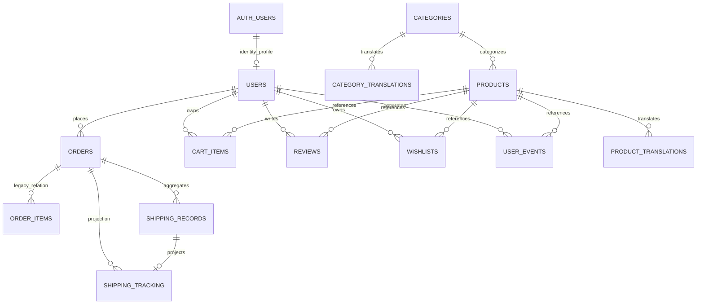

# Phase0 — Supabase metadata review

Ngày review: 03/11/2026. Nguồn: schema_report do owner gửi qua attachment; agent không kết nối Supabase. Owner xác nhận nền tảng Supabase, **chưa xác nhận staging/production**. Snapshot có thể không phản ánh thay đổi sau thời điểm export. Không lưu raw function bodies hoặc customer rows vào repository.

Update03/11: owner đã xác nhận database thử nghiệm. P1-02a tạo permission repair/rollback và chạy42authored migration regression checks trên synthetic PostgreSQL in-memory; chưa áp lên hosted DB. Chi tiết05-permissions-rollout.md. Initial findings bên dưới vẫn không phải chứng nhận exploit trên deployed Data API.

## Bằng chứng và completeness

Parse markdown table bằng JSON decoder sau khi bỏ escape `\|` do Markdown; không sửa giá trị metadata. Đủ13 sections: database1, extensions7, columns195, rls17, policies44, functions14, triggers5, constraints66, indexes65, publications1, table_grants463, column_grants2951, managed_tables27. Server PostgreSQL17.6. Metadata đã đủ để chốt thiết kế dựa trên schema quan sát được; deployment/account authorization vẫn là gate riêng.

Không có vector/unaccent trong danh sách extensions; có pg_trgm. Không có integration outbox/usage/GSC/PSI/Merchant delivery tables trong public17 tables. Không thấy supabase_migrations trong managed_tables: không suy migration history đầy đủ hoặc chưa có migration chỉ từ table visibility. Export không chứa enum labels, view definitions, default privileges, role memberships, schema USAGE hoặc Data API exposed schemas, và không chứa auth-table trigger definitions. Không thể dùng snapshot này làm chứng nhận security/live login/throughput.

Metadata consistency check phát hiện `information_schema.columns` còn có relation `products_with_discounts` (22 cột) ngoài17 base tables; tổng195 là173 cột bảng +22 cột relation này. Không coi đó là bảng mới để tạo trùng. Không có view definition/reloptions trong export nên chưa xác minh security_invoker, active-product filtering hoặc discount formula của view. Không dùng view này cho AI/feed trước khi kiểm tra contract và quyền; ProductsService/common pricing hiện tại tiếp tục là source. Check đầu giả định columns chỉ chứa base tables đã fail, được sửa bằng phân loại relation đúng; file nguồn không bị sửa.

## Observed ERD

Nullable owner relationships and delete behaviors must follow exported constraints, not diagram cardinality alone. Orders runtime still uses items JSON, shipping_info JSON, total; legacy total_amount/shipping_name/shipping_phone/shipping_address/order_items also exist. Không drop/backfill legacy columns trong upgrade. `users` chứa role/is_banned/email/phone/address; không dùng bảng này làm public profile endpoint.

## Reuse decisions đã kiểm tra với DB export

| Existing | Ý nghĩa | Quyết định |
| --- | --- | --- |
| shipping_records | kind shipment/action/inbox/event/cod/notification/...; unique key, version/CAS; order/owner FKs | Không tạo shipping_shipments, shipping_events, cod_ledger hoặc GHN inbox thứ2 |
| shipping_tracking | owner SELECT policy, authenticated chỉ SELECT; service_role writes; realtime publication | Giữ projection; không publish raw shipping_records |
| shipping RPCs | reserve/attach/write/complete_cod service_role only; paid-COD/cancel guards gắn orders | Giữ nguyên khi thêm provider khác |
| order transition | enforce_order_transition + transition_order service_role only | Tái sử dụng CAS/trigger, không replace order workflow |
| user_events | user/session/event/product/metadata; product_id NOT NULL, không dedupe/delivery lease fields | Tái sử dụng nếu đo hành vi sản phẩm nội bộ; không biến thành payment outbox hoặc tự cấp client INSERT |
| auth.identities | Bảng quản lý identity tồn tại, Google qua Supabase Auth | Không tạo external_identities/custom session; linking configuration chưa kiểm tra |
| vouchers | code unique, usage/discount constraints hiện có | Không thêm coupon table; concurrency là thay đổi transaction riêng |
| product media | images/variants JSON và storage đang dùng | Chưa cần media_assets trước Cloudinary POC |

## Source-grounded security concerns — NEEDS_VALIDATION

Các mục dưới là kết luận cấu hình từ metadata, **chưa có live exploit hoặc sandbox reproduction**. Không gán severity cho findings chưa validated. Nest guard không điều khiển direct Supabase access. Exposure qua Data API phụ thuộc schemas/role/schema grants hiện chưa được export.

1. **Role/banned fields:** authenticated có table UPDATE và column UPDATE trên users.role/is_banned; policy `Users can update own profile.` chỉ kiểm tra auth.uid()=id. Cột role không được ràng buộc bằng policy này; thêm policy admin permissive không làm policy owner chặt hơn. Account CUSTOMER có thể được cấp khả năng sửa chính role/is_banned nếu đường direct table được expose. Cần local owner-role fixture kiểm tra rejected UPDATE role/banned, allowed safe profile UPDATE và admin update qua backend.
2. **Public profile PII:** users SELECT grant cho anon/authenticated + policy public SELECT true. Snapshot chứa email/phone/shipping_address; điều kiện cho phép đọc rộng hơn intended private profile. Cần loại public table path hoặc public projection có field allowlist, giữ AuthProvider đọc profile của chính user.
3. **Blog writes:** posts INSERT/UPDATE/DELETE policies tên Admin có roles authenticated và check/qual true; không kiểm tra ADMIN/STAFF. Cần local role fixtures cho visitor/customer/staff/admin và guards ở direct DB path.
4. **Direct order insert:** orders authenticated INSERT + owner-id-only policy; không enforce trusted server pricing, paid state hoặc stock reservation trên INSERT. Order transition trigger chỉ UPDATE. Cần kiểm tra local fixture và quyền direct table thực tế trước tắt client INSERT; backend service role vẫn giữ create path.
5. **Contacts:** direct anon INSERT policy true có thể bỏ qua Nest throttle/Turnstile nếu Data API exposed. Turnstile server-side phải đi kèm đóng direct insert hoặc một trusted RPC; chỉ thêm guard Nest chưa đủ.
6. **SePay uniqueness:** transaction_code chỉ có index thường, chưa unique; không có transaction receipt/inbox tương đương trong public schema export. Giữ blocker financial review, không tạo unique index trước scan duplicate trên staging và quyết định handling.
7. **TRUNCATE grants:** anon/authenticated có TRUNCATE trên nhiều public tables; RLS không áp dụng TRUNCATE. Chưa chứng minh API/RPC nào cho phép gọi lệnh này; không suy public destructive exploit từ grant đơn lẻ.

Đối chiếu semantics: [PostgreSQL17 RLS](https://www.postgresql.org/docs/17/ddl-rowsecurity.html), [Supabase column privileges](https://supabase.com/docs/guides/database/postgres/column-level-security). Policies permissive kết hợp OR; RLS giới hạn hàng, không tự bảo vệ từng cột.

Focused review áp dụng skill security-audit ở guidance mode. Skill yêu cầu OS sandbox không network, target/toolchain read-only, env allowlist/scratch-only và resource limits cho execution. Tool execution sandbox hiện có chưa được chứng minh đáp ứng **tất cả** các điều kiện đó; vì vậy không chạy exploit harness/target security tests và không gọi confirmed. Đây là execution limitation, không phải yêu cầu owner cho phép probe production. Next safe validation là fixture do operator chạy trong isolated local/staging sandbox đáp ứng policy, không live customer accounts.

## Final proposed migration order (design only)

1. **P1 security permission patch riêng:** thu hẹp users protected columns + public PII, posts RBAC và direct orders/contacts mutation paths; test cả auth/theme/profile/checkout/service-role paths. Không áp tự động vì đổi grants/RLS có thể ảnh hưởng client hiện hữu; phải review staging và rollback privileges/policies trước apply. Không drop bảng/cột hoặc đổi order state machine.
2. **P1 durable provider infrastructure:** env registry thay config table; `integration_usage_daily` và `integration_outbox` chỉ cho non-shipping events/delivery chưa có equivalent. Durable event schema gồm unique dedupe key, source version, state/lease/version/attempts/due time; event insert chung transaction với source state khi hook payments. GIữ GHN inbox/notification identity qua bridge; không gộp thêm kind tùy tiện vào shipping_records.
3. **P2 diagnostics:** seo_search_metrics_daily unique property/day/dimensions + sync freshness và performance_audits url/strategy/time. OAuth refresh secret nằm server/encrypted, không client read policies.
4. **P4 email:** delivery state có thể ở integration_outbox nếu đủ fields, không tạo notification_deliveries trùng tự động. Một event/recipient/template key; unknown send outcome phải reconcile.
5. **P5 search:** FTS/unaccent theo extension availability/benchmark; pgvector/product_embeddings chỉ sau model dimension và relevance evidence.
6. **P7/8:** media mapping chỉ sau POC chứng minh lợi ích; merchant_sync_items unique account/product/locale/version cho delta/reconciliation, tái sử dụng catalog/stock source.

Không có SQL migration trong batch review. Registry/mock Phase1 có thể triển khai local sau Phase0 design completion; migration/external activation vẫn blocked bởi ENV-01 staging confirmation, account rights và security validation. Quyết định này không tự cấp permission production.
